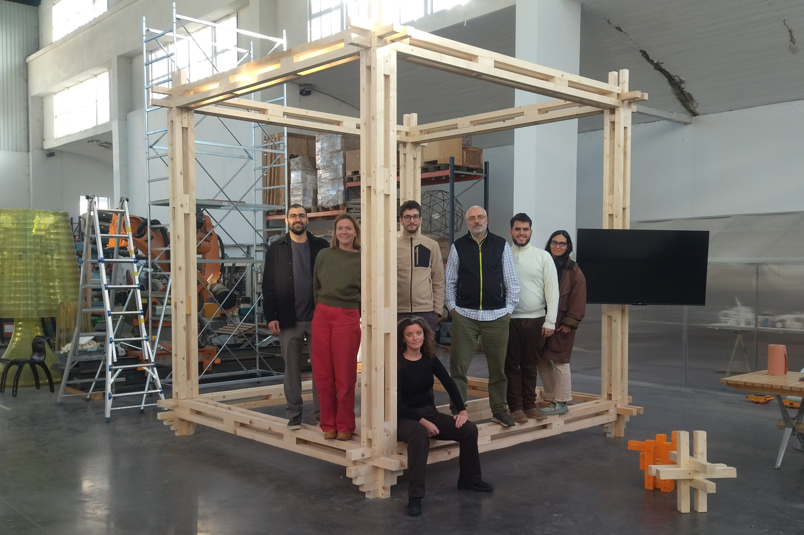
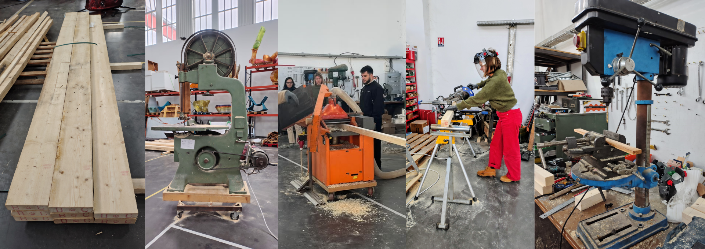
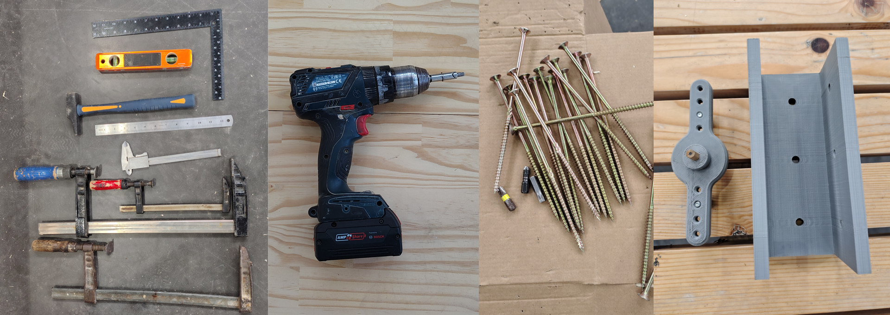
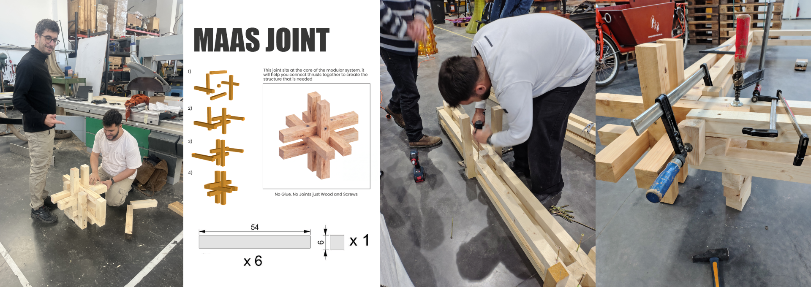
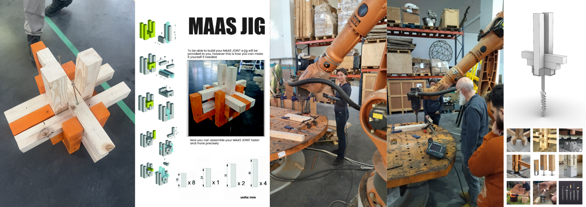
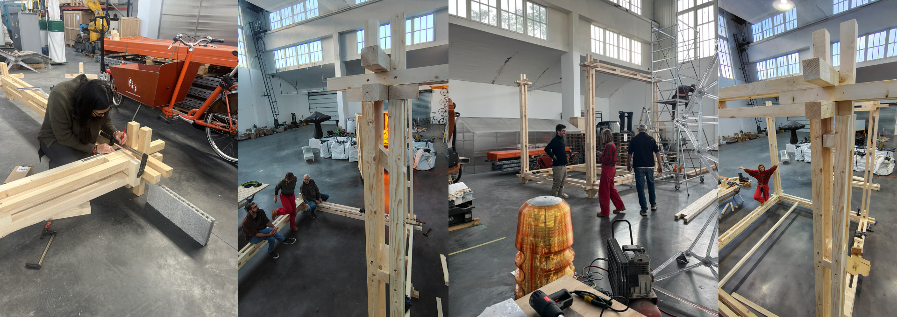
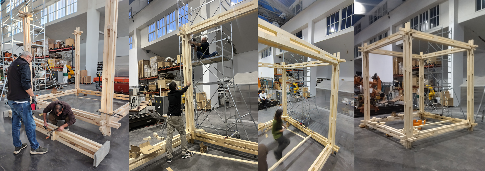
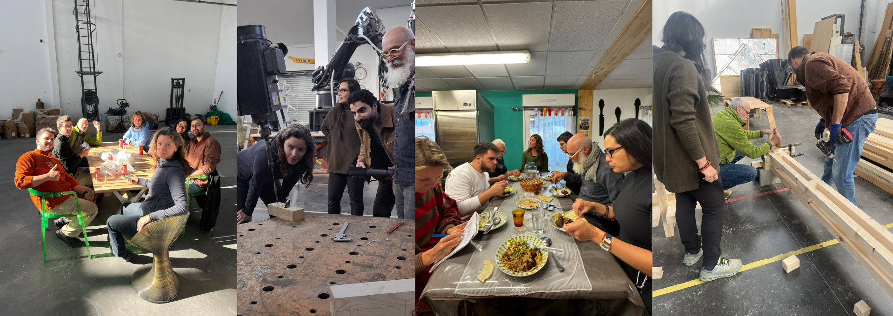

# MAAS — Modular Architectural Assemblage System Workshop

## First Iteration | Matières Numériques, Saint-Étienne | 26–30 October 2026

# Introduction

After a few unsuccessful attempts, we finally made it happen! The first iteration of the **M.A.A.S. — Modular Architectural Assemblage System** workshop took place at the Matières Numériques facility in Saint-Étienne, from October 26th to 30th, 2026.

First of all, I would like to thank [Guillaume Credoz](https://www.linkedin.com/in/guillaumecredoz/) and the entire [Matières Numériques](https://www.matieresnumeriques.org/) team for giving me this opportunity and, above all, for their perseverance in making it happen. A special thanks also goes to the people at [Post Industrial Craft](https://www.postindustrialcrafts.com/) for their support and assistance. Their workshop is a very special place, where all sorts of robotic magic happen!

I would also like to thank [Saint-Étienne Métropole](https://eco.saint-etienne-metropole.fr/en/) for supporting this initiative and making this unique opportunity possible.

Last but certainly not least, I want to THANK every single participant for their interest in the topic and for the energy, curiosity, and dedication they brought to these five intense days. They deserve full credit for their contribution to the workshop and its outcomes:

- LAMPERT Zulimar
- SALEM Oliver
- TORRES Florent
- DEMING Lauren
- HATEM Pierre
- DEFOSSEZ Juliette

It was a wonderful and intense week. I met a group of participants on the first day, but by the end, I was saying goodbye to friends. What a privilege!

# Workshop Goals

This workshop represents just the first iteration of the MAAS research project. Many more iterations will be necessary to develop, test, and validate the system, making it increasingly robust and reliable.

Conceived as a combination of design research and hands-on experimentation, the workshop focused on the design and 1:1-scale prototyping of a modular wooden structure, conceived as a collection of kits: physical components accompanied by assembly instructions.

More specifically, we concentrated on the design principles and guidelines for the **structural kits**, one of the foundational building elements of the system, alongside other components such as floors, walls, rooftops, patios, and so on.

The idea is to develop these elements as modular, independent components that allow future users to assemble and arrange them freely, generating different configurations according to their needs and local conditions.

Alongside the design process, we built full-scale prototypes to test their structural validity, fabrication feasibility, and assembly procedures. The resulting designs and assembly instructions will eventually contribute to an **open-source database of modular building kits**, enabling end users to access, adapt, and customise the system according to local contexts, available materials, and resources.

Beyond the pedagogical objectives of the workshop, which I won't discuss here, we also wanted to investigate some very practical questions:

- Could the structure be fabricated without relying on digital fabrication tools?
- Which tools and equipment would be necessary, and in what quantities?
- What level of dimensional precision could we achieve?
- How much time would wood processing require?
- Was the proposed assembly strategy effective? How long would assembly take, and what problems might arise?
- What are the actual limits of the structural concept? What are its strengths and weaknesses?

In other words, we wanted to move beyond the design concept and confront it with the realities of fabrication and construction.

# Processing Wood

Due to the quantity of timber required and the relatively short notice with which the workshop was confirmed, we had to purchase raw material that could then be processed on-site. We sourced locally produced Nordic white spruce from a nearby sawmill. The timber arrived as rough-sawn boards measuring 63 × 224 × 3,500 mm. Since the entire structural system is based on a standard 60 × 60 mm timber section, each board had to go through several machining operations before becoming suitable for assembly.

The processing workflow involved four main steps:

2. **Vertical bandsaw:** splitting each timber board into three pieces.
4. **Thickness planer:** squaring and dimensioning each piece to obtain the required 60 × 60 mm section.
6. **Sliding crosscut mitre saw:** cutting the pieces to their specified lengths, ensuring accurate 90° cuts.
8. **Vertical drilling machine:** drilling the holes required for the screw connections. We also designed and used some 3D-printed tools to help with positioning, checking, and marking the timber.

This phase proved to be one of the most demanding parts of the workshop, both in terms of time and labour. It also provided valuable feedback about the level of preparation required before assembly and the potential benefits of introducing digital fabrication in future iterations.

# Preparing the Kits

The structural module is composed of three different types of **kits**:

- **8 × Joint kits**
- **4 × Long beam kits**
- **8 × Short beam / column kits**

**Assembly tools**:

- Electric screwdriver
- F-clamps
- L-shaped square ruler

Each kit is conceived as a predefined collection of timber elements and connectors, with specific dimensions, quantities, and assembly procedures.

## Joint Kit

**Materials**

- 6 posts — 60 × 60 × 540 mm
- 1 spacer — 60 × 60 × 60 mm
- 6 screws — 160 mm

**Weight:** 6.1 kg

## Beam Type A — X Direction

**Materials**

- 4 posts — 60 × 60 × 2,940 mm
- 12 spacers — 60 × 60 × 180 mm
- 20 screws — 160 mm

**Weight:** 25.7 kg

## Beam Type B — Y & Z Directions

**Materials**

- 4 posts — 60 × 60 × 2,820 mm
- 12 spacers — 60 × 60 × 180 mm
- 20 screws — 160 mm

**Weight:** 24.8 kg

# Additional Experiments

Besides preparing and assembling the structural kits, some participants decided to investigate complementary aspects of the system. These parallel experiments were particularly valuable because they allowed us to explore potential improvements beyond the initial scope of the workshop.

## Assembly Jigs

To speed up the assembly of the joint kits and ensure accurate positioning of the timber elements, Oliver and Florent decided to design and build a dedicated jig.

Made from leftover wooden strips, the jig was intended to facilitate alignment and maintain the correct reciprocal 90° angles between the components.

Although the resulting jig was not sufficiently rigid to guarantee the required precision in every situation, it proved to be a useful addition. We also used it to demonstrate and explain the assembly procedure to visitors.

## Foundations

Juliette investigated possible foundation systems compatible with the modular structure.

The research focused on three main criteria:

- Compatibility with different types of terrain.
- Adaptability to the modular structural system.
- Ease and speed of deployment.

This investigation will be particularly important in future developments, as the system is intended to be adaptable to different contexts and site conditions.

## Robotic Digital Fabrication

Since we were working in a facility equipped with several industrial robots, including one fitted with a milling tool, Lauren decided to investigate the possibility of using robotic machining to produce the holes in the timber elements.

The experiment aimed to evaluate:

- Robotic milling cycle time.
- Machining quality and precision.
- Potential limitations and technical issues.

This was an interesting opportunity to compare conventional woodworking processes with robotic digital fabrication and to start considering how both approaches could coexist within the MAAS production strategy.

# Module Assembly

Despite being the first iteration of the system, the assembly phase turned out to be surprisingly straightforward.

We started by positioning the four joint kits on the ground. The four ground-level trusses (two Type A and two Type B) were then installed, followed by the four vertical columns (Type B).

The final step was placing the four upper beams. For this operation, we used a metal scaffolding structure to safely lift and position the elements.

Apart from the physical effort required to lift and handle the trusses, the whole operation went smoothly. The different components were positioned, aligned, clamped, and finally screwed together.

The assembly strategy proved to be effective, and the structural elements fitted together as expected.

## Improvements

The assembly process also highlighted a few aspects that could be improved in the next iteration:

- **Edge trimming:** all timber pieces should be slightly trimmed along their edges (approximately 2–3 mm) to facilitate interlocking and positioning during assembly.
- **Labelling system:** adding labels identifying each element and indicating its mounting direction would make the assembly process considerably easier for end users.
- **Lifting strategy:** a dedicated strategy for lifting and positioning the upper beams should be developed. We already have a few ideas, but their validity and ease of execution still need to be tested.

## Provisional Foundations

Since we did not install proper foundations, and the structure could not be assembled without transferring some stress to the joints, we had to find a temporary solution.  
We used leftover timber pieces to distribute the structure's weight and transfer the loads to the ground, adopting a sort of *Japanese-style* stacking strategy, with progressively shorter pieces.  
This was obviously a provisional solution, but it allowed us to complete the assembly and test the structural configuration.

## Assembly Tools

The tools required for the module assembly were:

- Electric screwdrivers.
- F-clamps.
- L-shaped square ruler.
- Precision spirit level.
- Rubber mallet.

# Feedback and Results

**The first MAAS structural module is finally built! And, more importantly, it works!**

The structure proved to be stable, reasonably strong, and relatively easy to assemble. Wood processing, on the other hand, was considerably more demanding than expected.

Together with the participants, we identified several possible improvements, but the overall results are encouraging. The basic structural concept has been successfully translated into a full-scale physical prototype, and the initial fabrication and assembly strategies have proved viable.

Of course, this is only a first experiment. Further testing, structural validation, and additional iterations will be necessary before the system can be considered a reliable and fully documented construction solution.

Nevertheless, we now have something tangible to work with: a first prototype that allows us to move the research forward, test new configurations, and refine the system based on actual fabrication and assembly experience.

And this is exactly what the workshop was about.

The MAAS project is now ready for its next iteration. And, by the way, if anyone out there is interested in collaborating, contributing to the research, or hosting a future workshop, **knock at my digital doors!**

# Next Steps

The next iteration will hopefully allow us to explore several new topics, organised around three main areas of development.

## MAAS Design & Development

- **Digital fabrication:** investigate digital fabrication processes for the kit components and test the improvements identified during the workshop, particularly regarding tolerances, structural performance, and assembly quality.
- **Tagging system:** develop a system for identifying and classifying individual components and kits, facilitating their management, fabrication, and assembly.
- **Documentation:** develop and release the final assembly instructions and official technical documentation.
- **Additional building systems:** explore alternative floor and wall systems and investigate how they could integrate with the existing structural module.

## MAAS Communication & Networking

- **Open-source platform:** identify and develop a suitable platform for sharing the project, its documentation, and the modular kit database.
- **Funding opportunities:** identify grants, funding programmes, and other opportunities to make future iterations and workshops financially sustainable.
- **Strategic partnerships:** establish collaborations with organisations and initiatives working on related topics, such as Le Grand Atelier and BaseHabitat.

## MAAS Education

- Identify schools, universities, and educational organisations interested in climate change adaptation, modular architecture, and alternative construction systems, particularly in relation to the challenges of displaced populations.
- The goal is to develop educational programmes and hands-on workshops focused on 1:1-scale prototyping, allowing students and participants to explore the design, fabrication, and assembly of modular structures through direct experimentation.

---

**This is just the beginning.**

MAAS is an ongoing research project, and its development depends on experimentation, collaboration, and the collective contribution of people willing to rethink how we design, fabricate, and assemble buildings.

The first module is built. Now it's time to see where we can take it!
